# 싸이 뛰어! 나폴리탄 괴담: 송천고 야간 경비 (Roblox)

## 이야기

1. 경비 회사 '싸이 경비용역'이 공유에게 송천고등학교 야간 경비 일을 맡긴다.
2. 진짜 송천고는 작년에 새로 지은 최신식 학교다. 그런데 공유가 찾아간 곳은 낡고 오래된 학교였다. 공유는 눈치채지 못한다.
3. 경비실 책상에서 이상한 '근무 수칙'을 발견한다.
4. 수칙을 읽고 겁에 질린 공유는 당근에 "학교 야간 경비 대타 5명" 글을 올린다.
5. 그리고 공유는 도망친다.
6. 글을 보고 온 5명(= 플레이어들)이 학교 앞 편의점에서 만나 SUV를 타고 학교에 들어간다.

그 학교는 **근무 수칙을 지켜야만 살아남는 나폴리탄 괴담**이었다.


## 전·후 비교

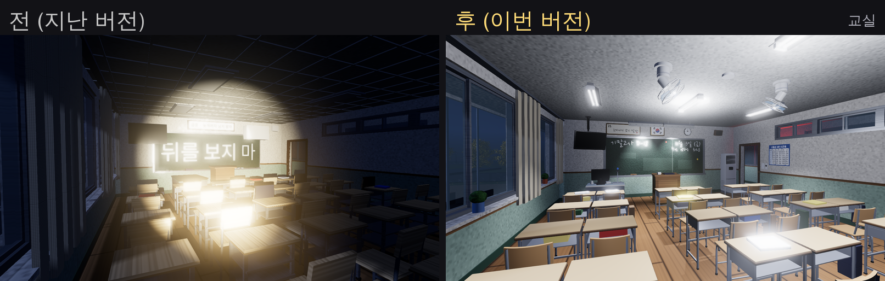
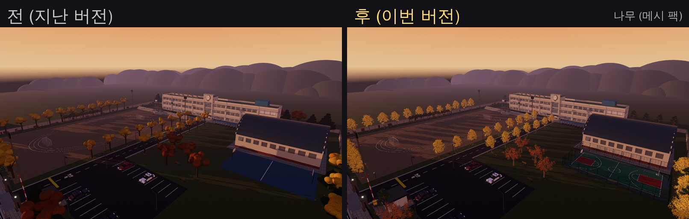
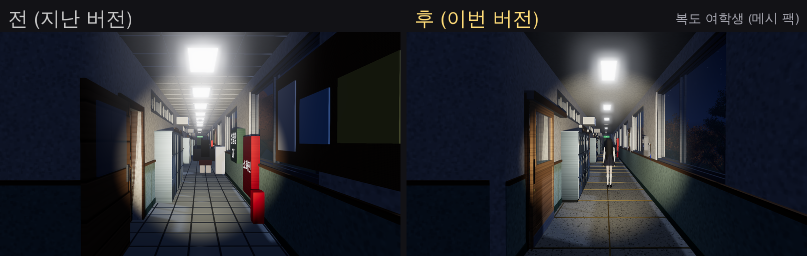

## 바로 해 보기 (Roblox Studio)

1. `build/SongcheonNightShift.rbxlx` 파일을 Roblox Studio로 연다.
2. **Lighting → Technology** 가 `Future` 인지 확인한다(파일에 넣어 두었지만, 아니면 직접 바꾼다). 실내 조명과 그림자가 이 설정에서 제대로 나온다.
3. **메시 팩 가져오기 (한 번만, 꼭 하기)**: 아래 "사실적인 나무·여학생·책걸상" 참고.
4. ▶ **Play** 를 누른다. 맵은 게임이 시작될 때 자동으로 지어진다. 파트가 약 45,000개라 처음엔 십몇 초 걸릴 수 있다. 미리 지어 두면 바로 시작된다(아래).

맵을 Studio 편집 화면에 미리 지어 두고 직접 고치고 싶다면, 편집 모드에서 **명령 바(View → Command Bar)** 에 아래 줄을 붙여 넣고 저장한다.

```lua
require(game.ServerScriptService.SchoolBuilder).Build(workspace, false)
```

`Workspace.School` 이 이미 있으면 게임 시작 때 다시 짓지 않는다.

### 사실적인 나무·여학생·책걸상 (메시 팩, 무료)

로블록스 파트(네모·공·원기둥)만으로는 실사 같은 나무나 사람을 만들 수 없다. 그래서 진짜 3D 메시를 `assets/SongcheonAssets.glb` 한 파일에 담아 두었다.

| 들어 있는 것 | 내용 |
|---|---|
| `Tree_Ginkgo` | 노랗게 물든 은행나무 (가지 + 잎 약 7,000장) |
| `Tree_Zelkova` | 주황빛 느티나무 (꽃병 모양으로 퍼진 굵은 가지) |
| `Tree_Pine` | 붉은 줄기의 소나무 (가지 끝마다 솔잎 덩어리) |
| `Ghost` | 복도의 여학생 (긴 생머리 760가닥, 교복 블라우스·조끼·주름치마·양말·구두) |
| `StudentDesk`, `StudentChair` | 2010년대 학생용 책상과 의자 |
| `Sedan` | 주인공 차: 1세대 K5(2010) 은색 세단. 실제 치수(4,845 × 1,835 × 1,455 mm, 축간 2,795 mm), 호랑이 코 그릴, 찢어진 헤드램프, 감싸는 테일램프, 10스포크 18인치 휠. 번호판 57누 2010 |

**가져오는 법**
1. Studio에서 **File → Import 3D** 를 누른다 (Home 탭의 **Import 3D** 버튼도 같다).
2. `roblox/assets/SongcheonAssets.glb` 를 고르고 **Import** 를 누른다. 업로드는 무료다.
3. Workspace에 `SongcheonAssets` 모델이 생기면 그대로 둔다. 게임이 시작될 때 스크립트(`AssetLibrary`)가 이 모델을 ServerStorage로 옮긴다. 그런 다음 맵의 나무 80여 그루, 책걸상 390세트, 이상현상 여학생을 이 메시로 바꾼다.
   - 메시 크기와 위치는 스크립트가 `AssetLibrary/Templates.lua` 값으로 다시 맞춘다. 그래서 가져올 때 단위 설정이 달라도 괜찮다.
   - 가져오지 않으면 파트로 만든 버전이 그대로 쓰인다. 게임은 돌아가지만 나무가 공 모양이고 여학생이 네모 인형이다.
4. 저장(게시)한다.

## 게임 흐름

1. **프롤로그**: 검은 화면에 위 이야기가 한 줄씩 나온다(건너뛰기 가능).
2. **로비**: 학교 앞 편의점에서 시작. 검은 SUV(좌석 5개)에 타면 10초 뒤 출발하고, 모두 같은 차를 타고 학교로 간다. 학교 주차장에는 공유가 버리고 간 K5가 서 있다.
3. **플레이어는 공유가 아니다**: 공유가 구한 대타 알바 5명이다. 모두 남색 경비복·경비 모자를 입고, 가슴 이름표와 머리 위 이름은 각자 자기 이름("경비원 ○○")이다(`Config.GUARD_OUTFIT = false` 면 자기 아바타 그대로). 전화나 방송은 여전히 "공유 씨"를 찾는다.
3. **1인칭 고정**: 걸을 때 화면이 살짝 흔들린다.
   - `Shift` 로 달린다(체력이 있다).
   - `F` 손전등, `R` 근무 수칙.
   - 로블록스 기본 UI와 이름표는 숨긴다.
4. **근무 시작 (22:00 ~ 06:00, 실제로는 10분)**: 경비실 벽에 붙은 **근무 수칙**을 읽는다(`R` 키).
5. 매시 정각 전에 **1·2·3층 순찰함**을 체크한다. 빼먹으면 정신력이 깎인다.
6. 학교 안에서 할 수 있는 일:
   - 교실 **미닫이문**을 열고 닫는다("문 열기 / 문 닫기").
   - **화장실은 남자·여자가 따로** 있고 갈색 여닫이문이다. **음악실 문은 가죽 방음문**(쌍문)이다.
   - 계단: 현관 앞 **중앙 계단**(1층~옥상)과 건물 **양 끝 학생용 계단**(1~3층).
   - 정문은 높은 미닫이 철문이고 쪽문은 잠겨 있다. 담·울타리·정문은 뛰어넘을 수 없다.
   - **경비실 문, 본관 현관 유리문, 1층 비상구, 화장실 칸 문**도 가까이 가서 누르면 열리고 닫힌다. 닫힌 문은 몸이 통과하지 못한다.
   - 2·3층 비상구, 옥상 문, 화장실 세 번째 칸은 잠겨 있다. 누르면 잠겨 있다는 말만 나온다.
   - 앞문 옆 **스위치**로 그 교실 형광등을 켜고 끈다.
   - 경비실 책상에서 **CCTV 보기**로 카메라 6대를 실제 화면으로 본다. `A`/`D` 로 바꾸고 `E` 로 나간다. 경비실 모니터 6개에도 실시간으로 나온다.
7. 무작위로 **이상현상**이 일어난다. 수칙대로 대처하지 않으면 정신력이 깎인다.
8. 06:00까지 버티면 **생존 엔딩**. 정신력이 0이 되거나 6시 전에 정문을 열면 **배드 엔딩**.

### 근무 수칙

1. 근무는 22:00 ~ 06:00. 06시 전엔 절대 정문을 열지 마세요.
2. 매시 정각 전, 1층·2층·3층 순찰함에 체크하세요.
3. 전화가 오면 받으세요. 단, 당신 이름을 부르면 끊으세요.
4. 4층은 없습니다.
5. 운동장에 의자가 있으면 쳐다보지 마세요.
6. 시계탑이 거꾸로 가면 건물에 들어가지 마세요.
7. 복도의 학생에게 말을 걸지 마세요. 학생들은 모두 하교했습니다.
8. 동상이 자리에 없다면, 찾지 마세요.
9. ~~(가끔 수칙 종이에 9번이 보였다가 사라진다)~~

### 이상현상 17가지

| 이상현상 | 수칙 | 내용 |
|---|---|---|
| 전화벨 | 3 | 경비실 전화. 이름을 부르면 6초 안에 끊어야 함. 안 받아도 감점 |
| 운동장 의자 | 5 | 운동장 한가운데 의자가 경비실을 보고 있음. 쳐다보면 1초마다 감점 |
| 시계탑 역회전 | 6 | 시계 바늘이 거꾸로 돔. 건물 안에 있으면 매초 감점 |
| 복도의 학생 | 7 | 얼굴을 머리카락으로 가린 여학생. "말 걸기"를 누르면 크게 감점 |
| 4층 | 4 | 옥상 계단실 문 너머에 없어야 할 4층 복도가 생긴다 (표지판 없음). 들어가면 계속 감점, 끝까지 가면 끌려 나옴 |
| 사라진 소녀상 | 8 | 책 읽는 소녀상이 복도로 이동. 가까이 가면 감점 |
| 정문 두드림 | 1 | "아저씨 문 좀 열어 주세요!" 문을 열면 배드 엔딩 |
| 복도 조명 깜빡임 | - | 분위기용 |
| 교내 방송 | - | "공유 학생은…" |
| 칠판 글씨 | - | 가까운 교실 칠판의 원래 글씨가 지워지고 "뒤를 돌아보지 마"가 한 획씩 써진다 (분필 손글씨) |
| 책상 반전 | - | 한 교실의 책상이 전부 뒤로 돌아 있음 |
| 석고상 | - | 미술실 석고상이 플레이어 쪽으로 고개를 돌림 |
| CCTV 4번 | - | 4번 화면(2층 복도)에 여학생이 서서 카메라를 올려다봄 |
| 화장실 세 번째 칸 | - | 노크 소리, 거울에 피로 쓴 "열어줘", 칸 문에 핏자국 손바닥. 문을 열면 감점 |
| 현관 거울 | - | 1층 현관 거울에 피로 쓴 "너도 남아" |
| 교실 문 | - | 아무도 없는 교실 미닫이문이 저절로 드르륵 열렸다 닫혔다 |
| 교실 불 | - | 빈 교실 하나에 형광등이 켜지고, 잠시 뒤 깜빡거림 |

칠판·피 글씨는 Roblox 기본 글꼴이 아니라 **손글씨 획을 하나하나 파트로 그린 것**이라 실제 분필·피 글씨처럼 보인다.

## 교실 (2010년 무렵 한국 고등학교)

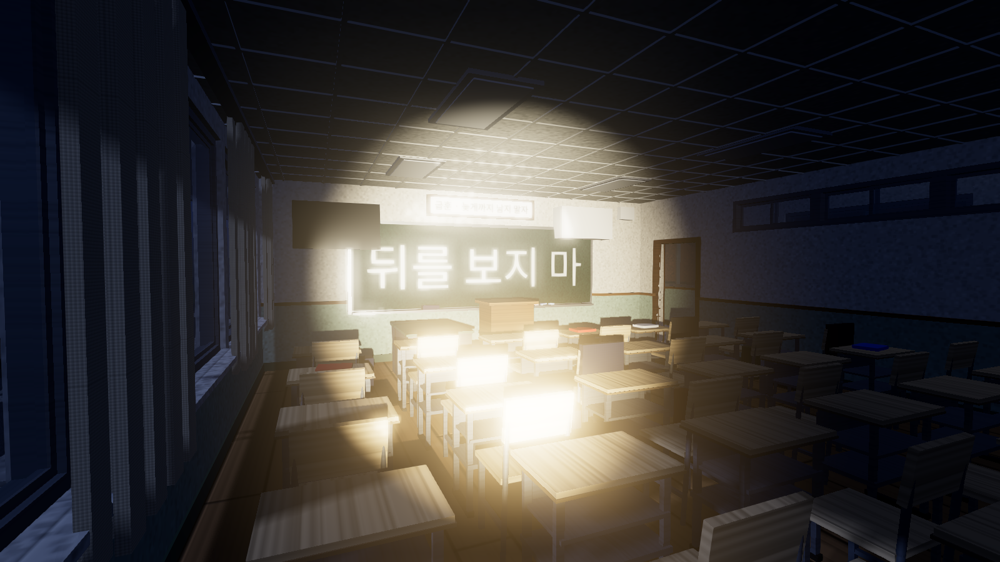

- **천장형 TV 브라켓**: 앞쪽 창가 구석 천장에 고정판, 회전부, 길이 조절 파이프(고정핀), 기울기 관절, 받침 팔, VESA 판이 있다. 거기에 50인치 LCD TV(전원 LED, 전선)가 학생 쪽을 보도록 비스듬히 걸려 있다.
- **미닫이문**: 나무 문틀(세로틀·가로틀·중간틀), 위쪽 유리, 아래 판재, 유리 누름대, 양면 스테인리스 발판, 오목 손잡이, 열쇠 구멍이 있다. 복도 쪽 윗 레일과 바닥 레일을 따라 실제로 옆으로 밀린다.
- **앞벽**:
  - 녹색 칠판: 알루미늄 테두리, 분필 받침, 분필·지우개·지시봉·자석. 오른쪽에 날짜·주번 칸이 있다.
  - 칠판 위: **태극기 액자**(국기법 비율과 4괘), **붓글씨 급훈** "늦게까지 남지 말자"(낙관), 벽시계(3-4반 시계만 4시 44분), 방송 스피커.
- **앞쪽 구석**: 스탠드형 에어컨, 교탁, 교사용 책상(유리 깔판, 모니터, 키보드, 실물화상기, 사무용 의자)
- **천장**: 2등용 형광등(반사갓) 6개와 칠판 조명, 보호망 달린 회전 선풍기 2대, 화재감지기
- **책걸상**: 2인 1조 3분단 × 5줄 = 30세트. 무늬목 상판, 철제 다리, 책 받침, 가방 고리가 있고, 가방·교과서·체육복이 군데군데 있다.
- **뒤쪽**:
  - 사물함, 학급 게시판(초록 부직포 + 알루미늄 테두리, 급식표·청소 당번표·학급 규칙…)
  - 청소함, 쓰레기통·분리수거함
- **기타**: 시간표, 전등 스위치, 선풍기 조절기, 창틀 화분, 커튼

## 이미 올려 둔 것 (aied0 계정)

손글씨 그림 4장과 메시 팩은 Open Cloud 로 이미 올려 두었다. 게임 서버가 시작할 때 저절로 불러온다.
- 손글씨 데칼: `Config.TEXT_ATLAS_DECAL_IDS`
- 메시 팩 모델: `Config.MESH_PACK_ID`

**단, 이 게임을 aied0 계정으로 한 번 Publish 해야 한다** (File → Publish to Roblox).
로블록스는 게임 주인이 올린 에셋만 불러오게 하기 때문이다. Publish 하지 않고 Play 하면 손글씨는 기본 글꼴로, 나무·여학생은 파트 버전으로 보인다.

## 손글씨 글자 그림 올리기 (직접 다시 올릴 때)

로블록스는 글꼴 파일을 직접 쓸 수 없다. 그래서 분필·피·수첩 글씨를 아래 글꼴로 그린 그림 4장(`text_atlas/atlas_1.png ~ atlas_4.png`)으로 만들었다. 게임은 이 그림에서 한 줄씩 잘라 보여 준다. 예전처럼 획마다 파트를 쓰지 않아서 맵이 약 7,000파트 가벼워졌다.

| 글꼴 | 쓰는 곳 |
|---|---|
| 그리운 경찰감성체 (무서운 분위기) | 칠판의 "뒤를 돌아보지 마", 피 글씨 "열어줘", "4층은 없습니다", "내려가" |
| RF대충쓴준우체 v3 (제정신 아닌데 귀여움) | "너도 남아", "누구세요?", "같이 놀자♡", 수첩의 9번 수칙 |
| 히조이체 ExtraLight (평범한 손글씨) | 칠판 날짜·주번·알림, 급훈, 근무 수칙 수첩 |

**올리는 법**
1. Studio → **Asset Manager → Images → Import** 로 `roblox/text_atlas/` 의 그림 4장을 올린다(무료).
2. 각 그림에서 우클릭 → **Copy Asset ID**.
3. `ReplicatedStorage.Config` 의 `TEXT_ATLAS_IDS = { 0, 0, 0, 0 }` 에 순서대로(1~4번) 넣는다.

넣기 전에는 같은 글이 로블록스 기본 글꼴로 보인다. 글꼴 파일은 저장소에 올리지 않았다. 글을 바꾸려면 `roblox/fonts/` 에 글꼴을 넣고 `node tools/make_atlas.js` 로 그림을 다시 만든 뒤, 그림을 다시 올린다.

## 근무 수칙 수첩과 경비실

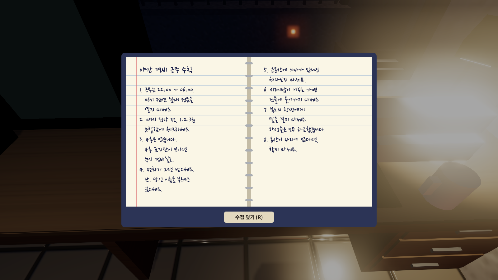

- 근무 수칙은 벽 종이가 아니라 **책상 위 수첩**에 손글씨로 적혀 있다. `R` 키나 수첩의 "수첩 보기"로 크게 본다.
- 손글씨는 히조이체 그림 글자(위 "손글씨 글자 그림 올리기")다. 수칙을 바꾸면 `tools/make_atlas.js` 의 `NOTEBOOK` 도 고치고 다시 실행한다.
- 경비실: 서랍 달린 책상, 탁상 달력(11월 13일 금요일), 스탠드, 무전기 충전대, 냉온 정수기, 간이침대, 열쇠함, 난로, 벽시계, 비상 연락망, 소화기.

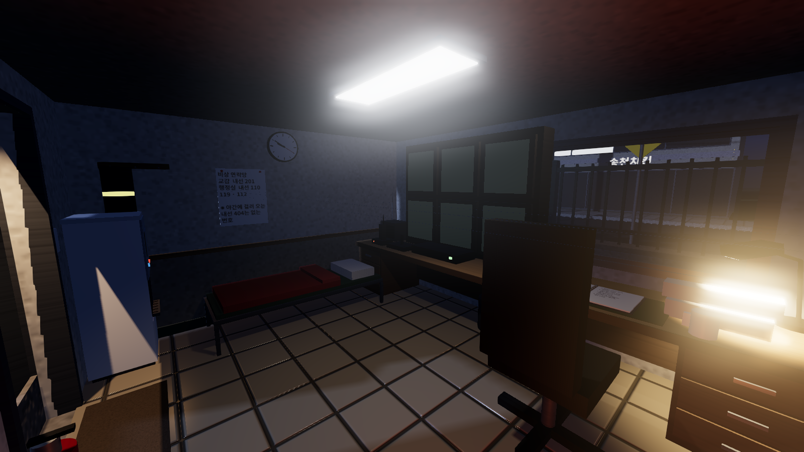

## 맵 구성 (파트 약 45,000개 + Roblox Terrain + 메시 팩)

- **실제 축척**: 1 stud ≈ 0.3 m. 층고 3.75 m, 교실 9 m × 7.5 m, 복도 폭 2.4 m.
- **Roblox Terrain**: 잔디(풀잎 장식), 마사토 운동장, 포장 지형을 쓰고, 먼 산은 지형 능선으로 만들었다.
- **11월 가을**: 노란 은행나무 가로수, 주황 느티나무, 소나무, 바닥에 떨어진 은행잎.
- **본관 3층**:
  - 교실 13개 (위 참고)
  - 특별실: 교무실, 행정실, 보건실, 방송실, 과학실, 도서실, 음악실, 미술실
  - 층마다 화장실, U자 계단, 1층 현관
  - 바깥: 시계탑(실제로 시간이 흐름)과 옥상
- **복도**:
  - 인조석 바닥과 황동 줄눈
  - 옥내소화전함(발신기·표시등·경종·호스)과 소화기
  - 순찰함과 순찰일지, 게시판, 정수기, 철제 사물함, 천장에 매단 층 안내 표지
  - 물건은 창문과 창문 사이 벽에만 붙어 있다
- **경비실**: CCTV 랙과 모니터 6대, 전화기, 근무일지, 근무 수칙, 열쇠함, 간이침대, 난로, 정수기, 차단기
- **교정**:
  - 운동장과 스탠드, 조회대, 국기 게양대, 등나무 쉼터, 철봉, 조명탑
  - 체육관, 농구장(선·골대·그물·펜스)
  - 주차장, 자전거 보관대, 책 읽는 소녀상
- **학교 밖**: 왕복 2차선 도로, 전봇대와 처진 전선, 버스정류장, 15~17층 아파트 6동, 상가 건물(간판·교회 십자가·약국·이발소)

## 미리보기 사진

`screenshots/` 폴더에 있다. 아래 사진은 **Roblox 화면 캡처가 아니다.** 게임과 **같은 맵 데이터와 같은 메시 팩**을 three.js로 그린 미리보기다. 실제 Roblox(Future 조명)에서는 색감과 빛이 조금 다르게 보인다.
- 사진은 **메시 팩을 가져온 뒤의 모습**이다.
- 여학생, 칠판 경고, 피 글씨, 4층, 의자는 이상현상이 일어난 순간을 보여 주려고 띄운 것이다.

| | |
|---|---|
| 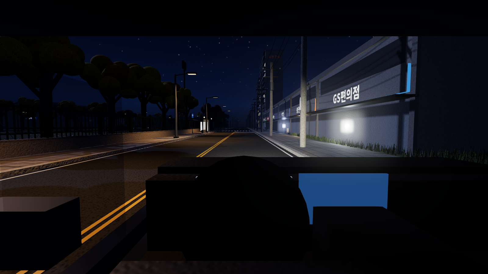 인트로: 운전석 시점 | 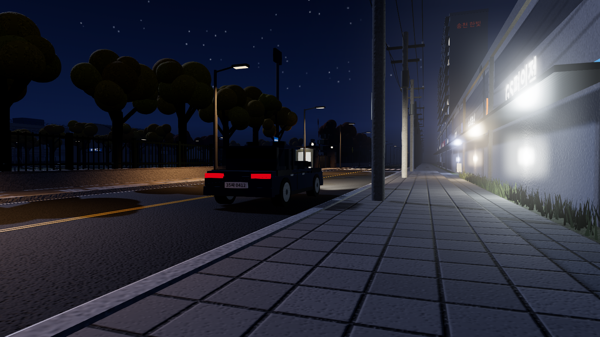 인트로: 학교 앞 도로 |
| 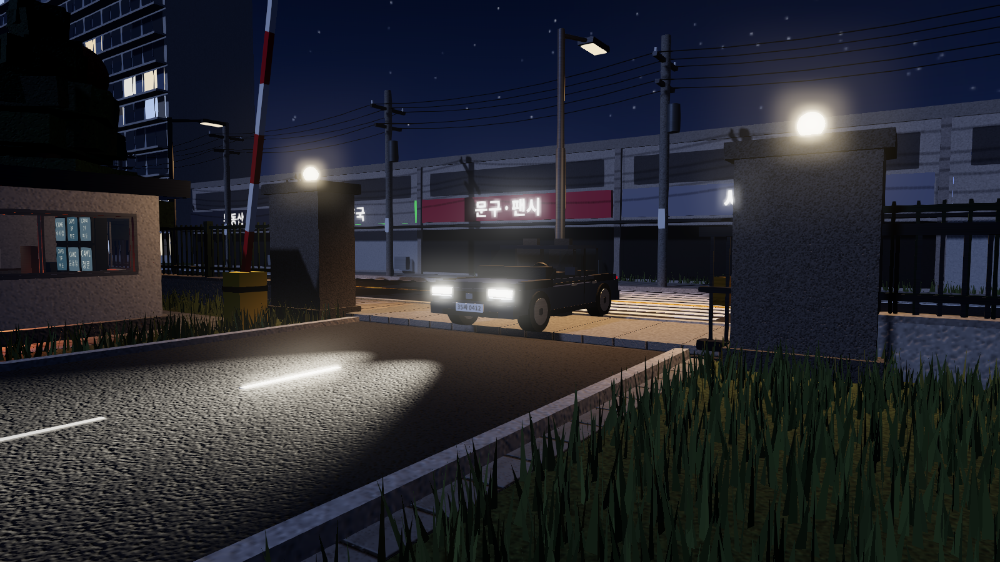 인트로: 정문 도착 | 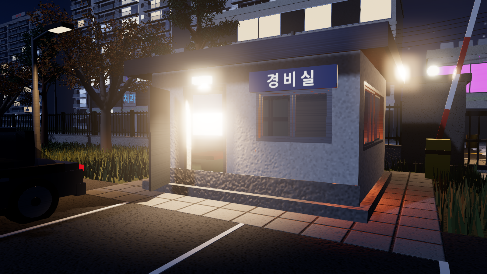 경비실 |
|  경비실 안 | 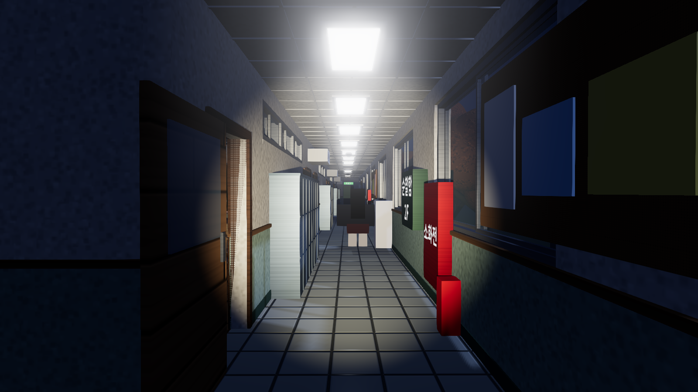 2층 복도의 여학생 |
|  교실 (스위치로 불 켬) | 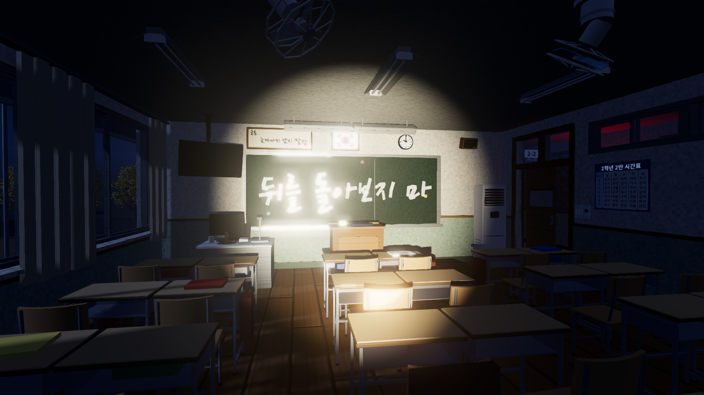 밤 교실 "뒤를 돌아보지 마" |
| 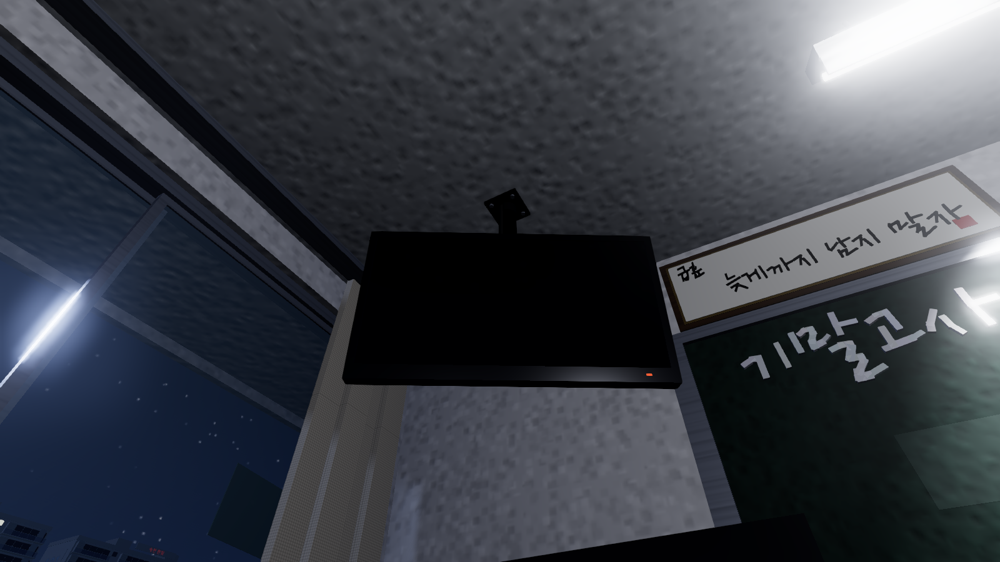 천장형 TV 브라켓 | 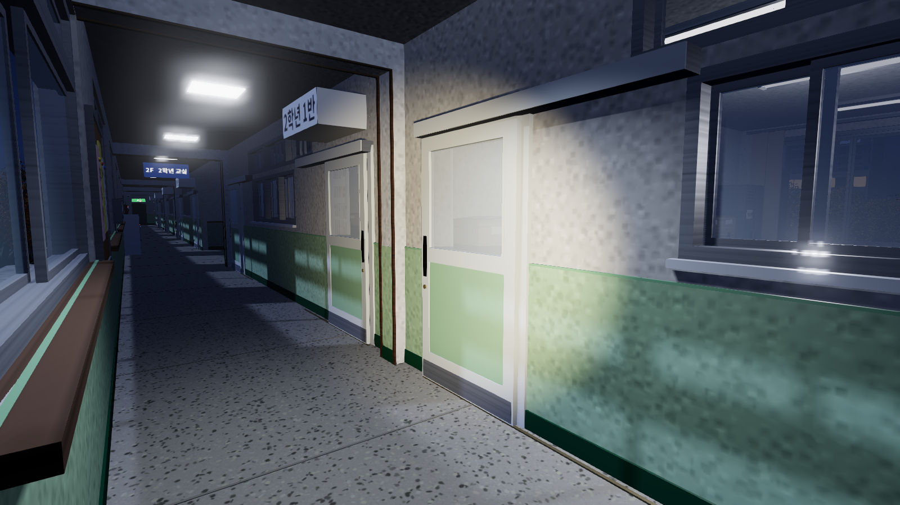 교실 미닫이문 |
| 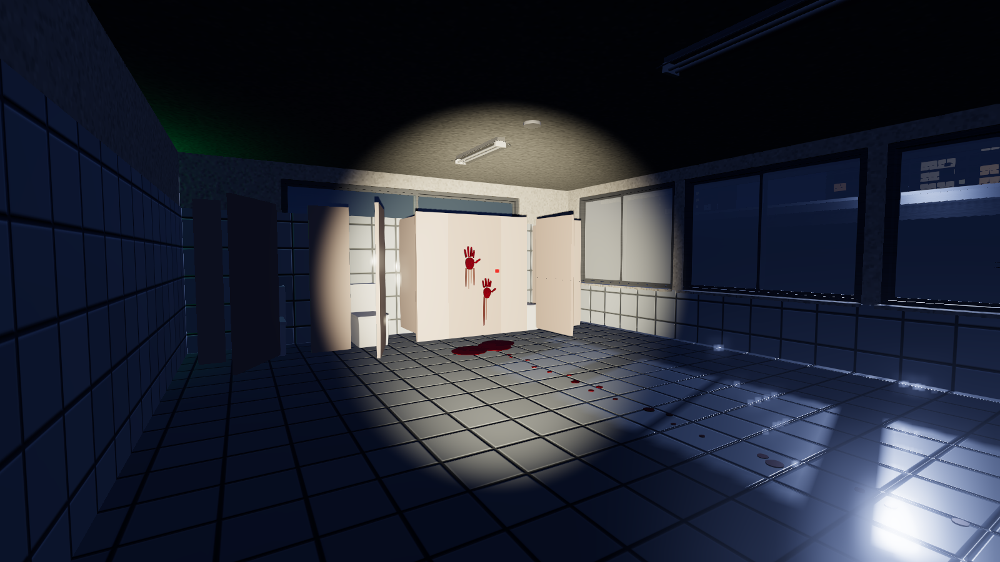 3층 화장실 세 번째 칸 | 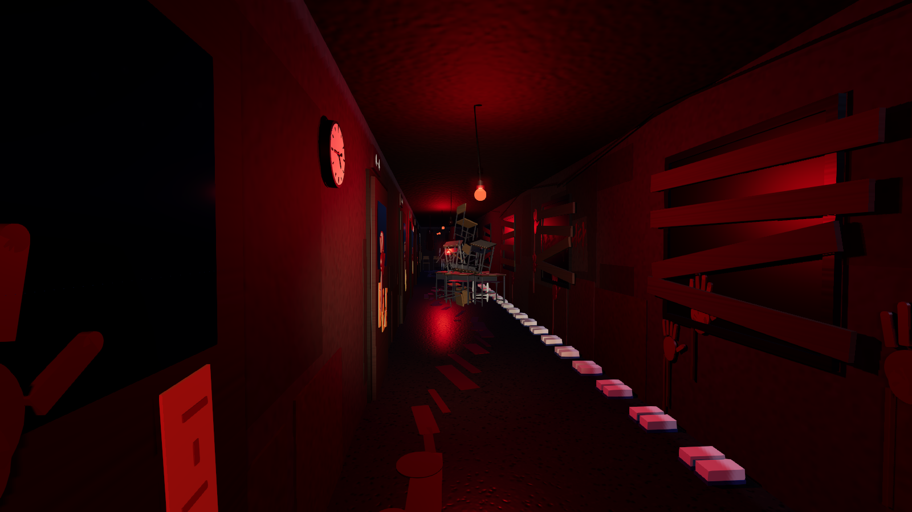 없어야 할 4층 |
| 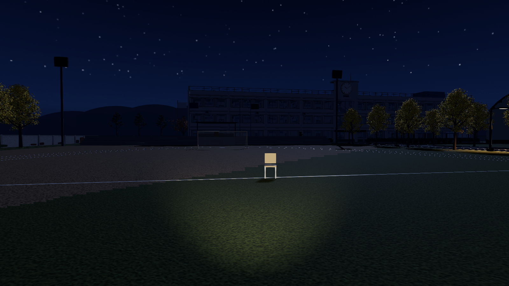 운동장 한가운데 의자 | 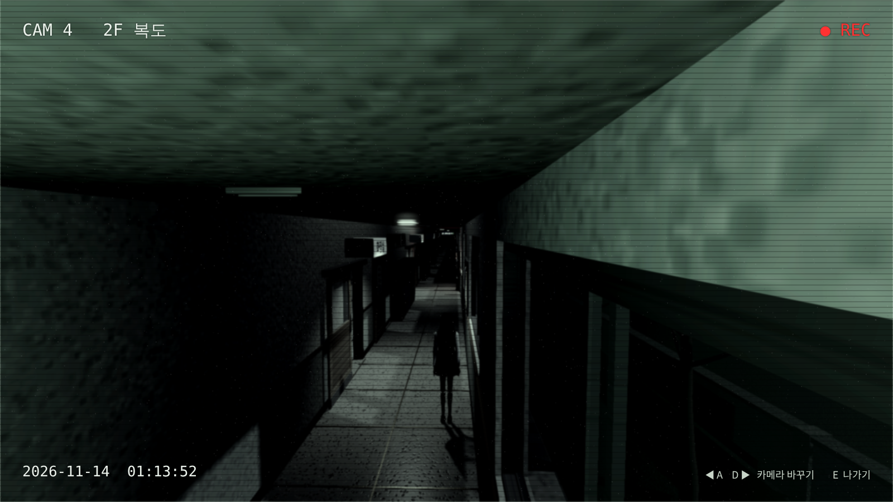 CCTV 4번 화면 |
| 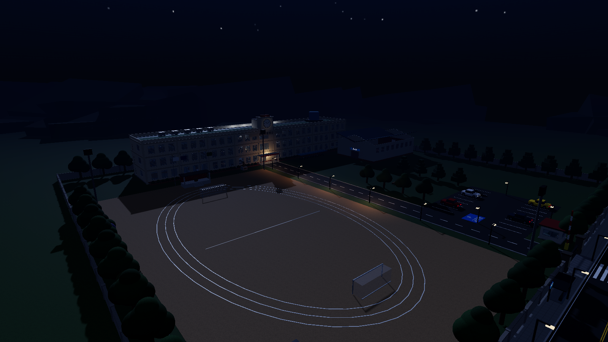 밤의 학교 전체 | 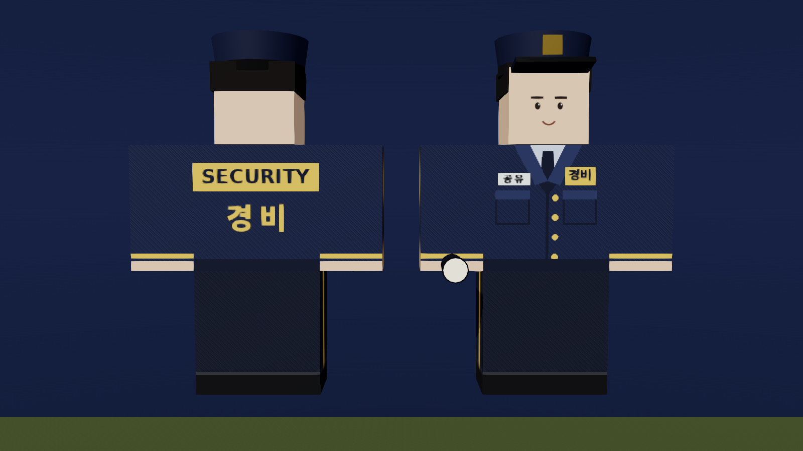 플레이어가 입는 경비원 공유 차림 |

## 공유 차림: 무료인가요?

**네, 무료예요.** 게임 안에서만 입히는 옷은 돈이 들지 않는다. 로벅스는 마켓에 판매용 옷을 올릴 때만 든다.

- 스크립트(`GuardOutfit`)가 들어온 플레이어를 **경비원 공유**로 바꾼다. 바뀌는 것:
  - 몸을 기본 몸으로 맞추고 모자·가방 같은 장신구를 벗긴다.
  - 남색 경비복, 경비 모자, 이름표, 팔 표지, 손전등, 머리 위 이름 "경비원 공유"
- 아래 설정을 하면 이름표·단추·"SECURITY 경비" 무늬까지 들어간 진짜 옷이 입혀진다.
  1. Studio → **Asset Manager → Images → Import** 로 `clothes/guard_shirt.png`, `clothes/guard_pants.png` 를 올린다(무료).
  2. 각 이미지에서 우클릭 → **Copy Asset ID**.
  3. `ReplicatedStorage.Config` 의 `SHIRT_IMAGE_ID`, `PANTS_IMAGE_ID` 에 그 숫자를 넣는다.
- 머리 모양이나 얼굴을 바꾸고 싶으면 마켓의 **무료** 아이템 ID를 `HAIR_ACCESSORY_ID`, `FACE_ID` 에 넣는다.
- ⚠️ 실제 배우 사진이나 얼굴을 그대로 넣는 건 초상권 문제가 있고, Roblox 규칙에도 걸릴 수 있다. 우리 세계관의 오리지널 캐릭터 "공유"로 그렸다.

## 폴더

```
roblox/
  build/SongcheonNightShift.rbxlx   ← Studio에서 여는 파일
  assets/SongcheonAssets.glb        ← 메시 팩 (Import 3D로 한 번 가져오기)
  src/                              ← 스크립트 원본 (Rojo로 연결해도 됨: default.project.json)
    ReplicatedStorage/Config.lua      설정 (옷 ID, 시간, 수칙, 인트로 대사, 소리…)
    ServerScriptService/Main.server.lua  근무 시간·순찰·정신력·정문·미닫이문·전등 스위치·엔딩
    ServerScriptService/Anomalies.lua    이상현상 17가지
    ServerScriptService/GuardOutfit.lua  플레이어 → 경비원 공유
    ServerScriptService/AssetLibrary/    메시 팩 적용 (Templates.lua 는 자동 생성)
    ServerScriptService/SchoolBuilder/   맵 빌더 + 맵 데이터(자동 생성)
    StarterPlayerScripts/Client.client.lua  인트로, 1인칭·달리기·머리 흔들림, UI, 손전등, CCTV 보기, 엔딩
  clothes/                          ← 셔츠·바지 템플릿 PNG (무료 업로드용)
  tools/                            ← 맵 생성기, 손글씨 획 만들기, 메시 팩 만들기, 미리보기 렌더러
  screenshots/
```

### 벽·바닥·천장 실사 텍스처

Roblox 기본 재질(회반죽·벽돌)은 표면이 클레이처럼 울퉁불퉁해서, 실제 표면 그림을 직접 만들어 붙인다.
- `tools/make_textures.js` 가 이음매 없이 반복되는 그림 7장을 만든다(`textures/`): 칠한 벽, 회색 아랫벽, 붉은 벽돌, 인조석 바닥, 마루, 천장 텍스, 콘크리트.
- 7장은 aied0 계정에 데칼로 올려 두었다(`Config.SURFACE_TEXTURE_DECALS`).
- 게임이 시작되면 `SurfaceTextures.lua` 가 본관·체육관의 벽·바닥·천장에 그림을 붙인다. 이웃한 벽끼리 무늬가 이어진다.
- 게시하지 않은 상태에서는 그림을 못 불러와 기본 재질로 보인다.

### 맵을 고친 뒤 다시 만들기

```bash
cd roblox/tools
node generate.js        # 맵 데이터 다시 생성 (src/.../MapData*.lua, build/map.json)
node check_data.js      # 데이터 검사
node audit_overlap.js   # 복도·교실 물건이 창문과 겹치는지 검사
node audit_collision.js # 문을 다 닫았을 때 걸어서 닿는 곳을 지도로 출력 (벽·문에 구멍이 있는지 확인)
node build_place.js     # build/SongcheonNightShift.rbxlx 다시 만들기
# 아래는 Playwright(Chromium)와 node_modules(three, @fontsource/*) 가 필요
node make_atlas.js                              # 손글씨 글자 그림 (roblox/fonts/ 의 글꼴 필요)
NODE_MODULES=<경로> node assets/build_assets.js # 메시 팩 GLB + Templates.lua
NODE_MODULES=<경로> node preview/shoot.js       # 미리보기 사진 (PACK=0 이면 메시 팩 없이)
```

## 소리

`Config.SOUNDS` 에 Creator Store 사운드 ID를 넣으면 소리가 난다. 0이면 자막만 나온다.
- 전화벨, 노크, 종소리, 방송 잡음, 배경음
- 전화 목소리 (`PhoneVoiceVice1`, `PhoneVoiceVice2`, `PhoneVoiceStranger`, `PhoneBreath`): 직접 녹음한 음성을 올려 ID를 넣으면 수화기에서 들린다
- 분필 긁는 소리, 미닫이문, 전등 스위치
