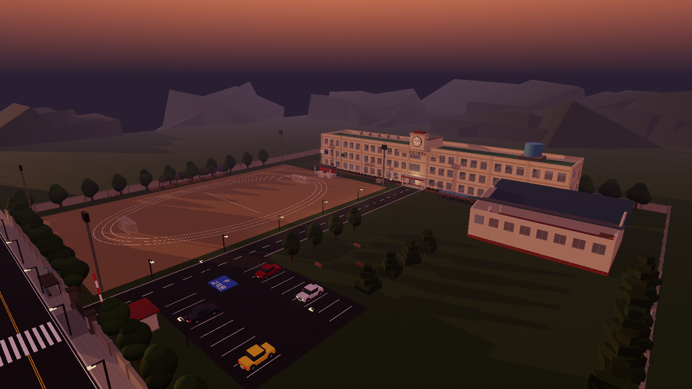
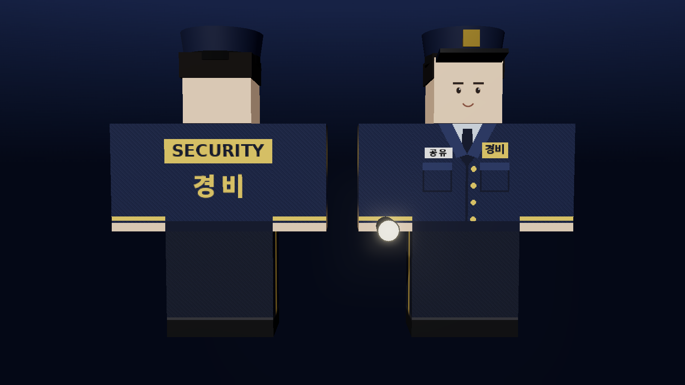
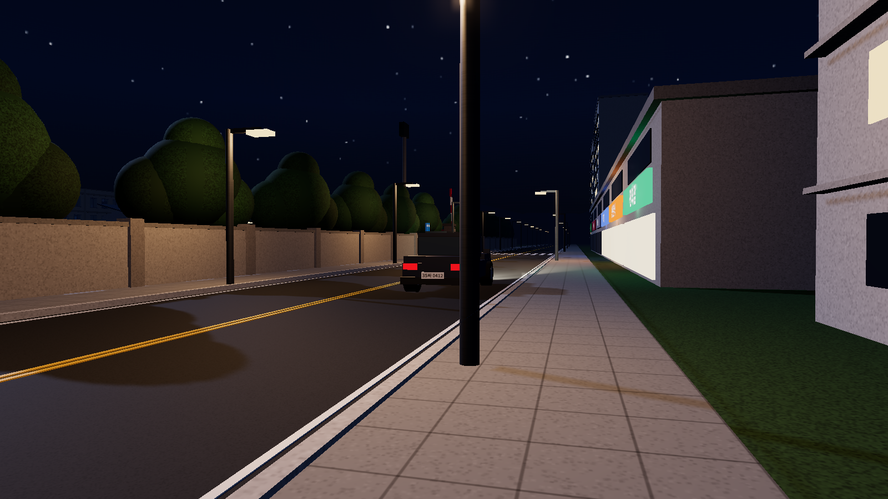
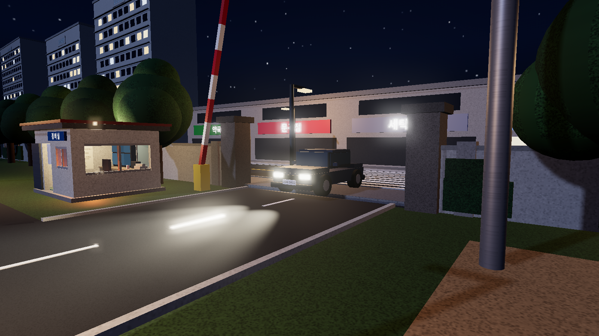
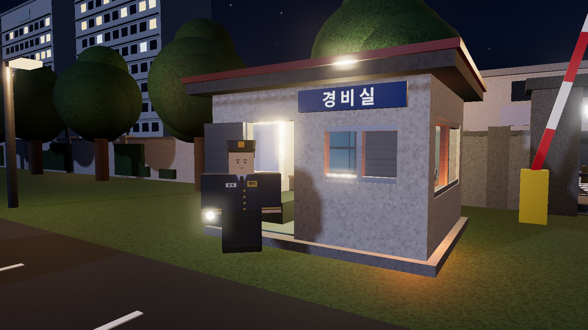
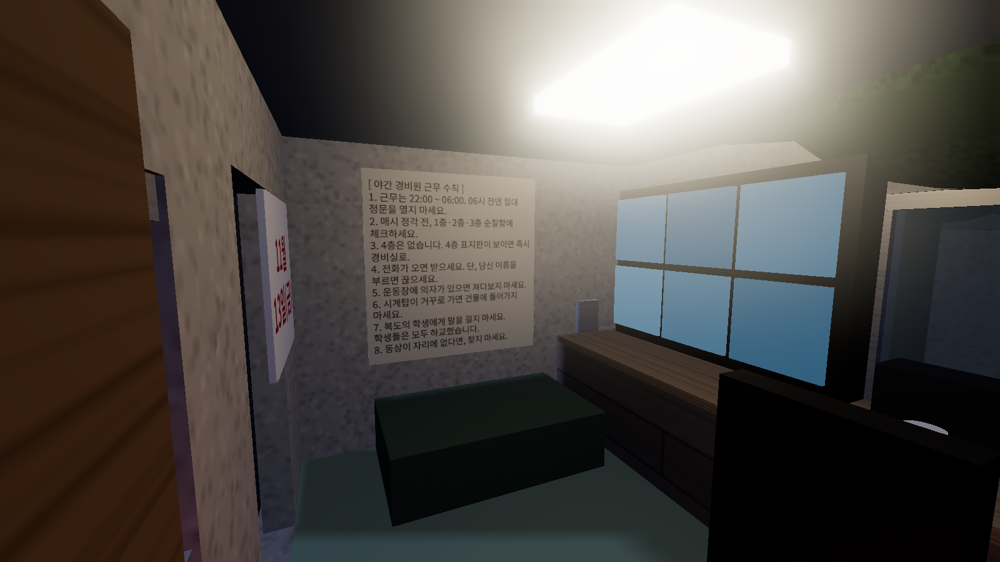
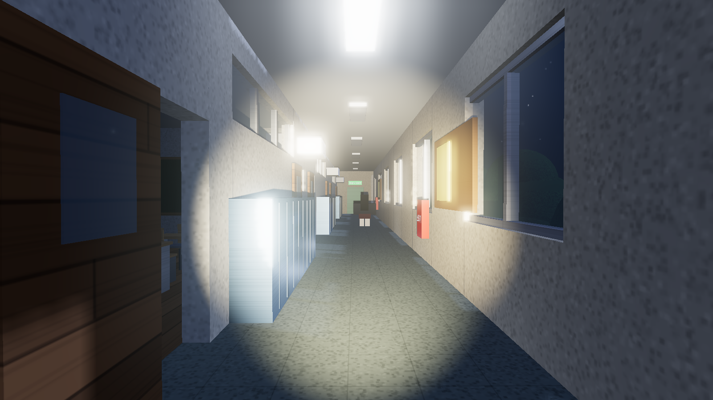
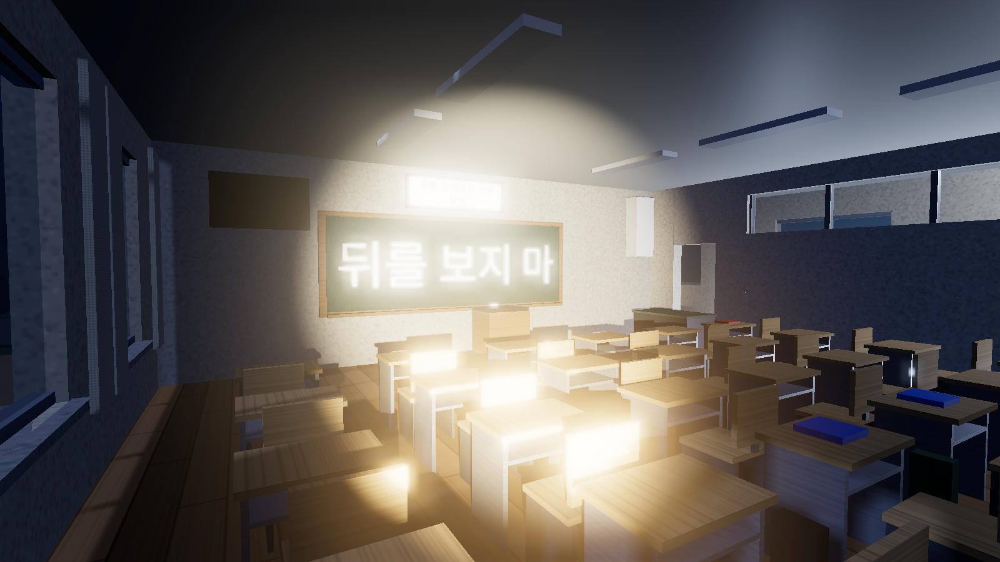
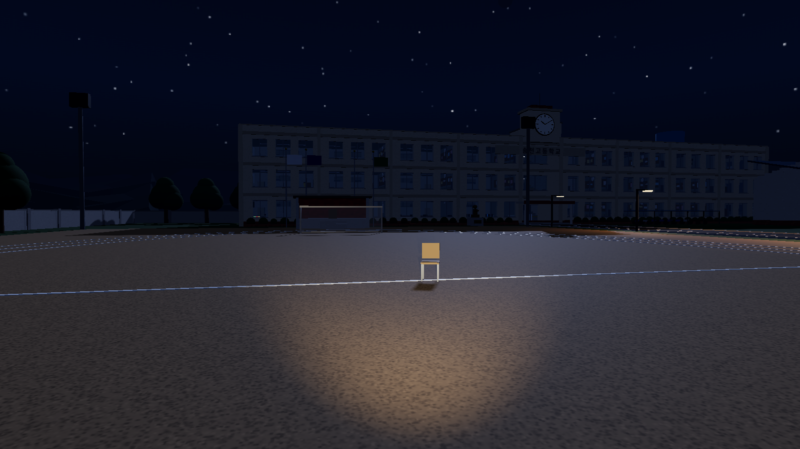
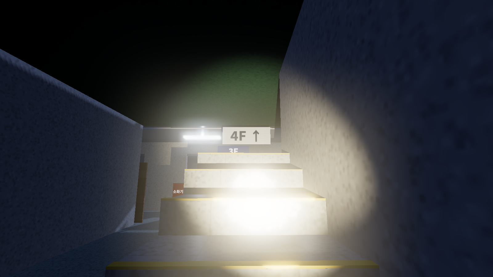

# 싸이 뛰어! 나폴리탄 괴담: 송천고 야간 경비 (Roblox)

경비원 공유가 시급 3만 원짜리 야간 경비 알바를 하러 송천고등학교에 간다.
그런데 그 학교는 **근무 수칙을 지켜야만 살아남는 나폴리탄 괴담**이었다.



## 바로 해 보기 (Roblox Studio)

1. `build/SongcheonNightShift.rbxlx` 파일을 Roblox Studio로 연다.
2. **Lighting → Technology** 를 `Future` 로 바꾼다. 조명과 그림자가 훨씬 예뻐진다. 이 설정은 스크립트로 못 바꾼다.
3. ▶ **Play** 를 누른다. 맵은 게임이 시작될 때 자동으로 지어진다. 파트가 약 9,800개라 몇 초쯤 걸린다.

맵을 Studio 편집 화면에 미리 지어 두고 직접 고치고 싶다면, 편집 모드에서 **명령 바(View → Command Bar)** 에 아래 줄을 붙여 넣고 저장한다.

```lua
require(game.ServerScriptService.SchoolBuilder).Build(workspace, false)
```

`Workspace.School` 이 이미 있으면 게임 시작 때 다시 짓지 않는다.

## 게임 흐름

1. **인트로**: 밤 9시 50분. 공유가 차를 몰고 학교 앞 도로를 달리다 정문으로 들어간다. 정문이 혼자 열리고, 주차하고 나면 문이 저절로 닫힌다.
2. **근무 시작 (22:00 ~ 06:00, 실제로는 10분)**: 경비실 벽에 붙은 **근무 수칙**을 읽는다(`R` 키).
3. 매시 정각 전에 **1·2·3층 순찰함**을 체크한다. 빼먹으면 정신력이 깎인다.
4. 무작위로 **이상현상**이 일어난다. 수칙대로 대처하지 않으면 정신력이 깎인다.
5. 06:00까지 버티면 **생존 엔딩**. 정신력이 0이 되거나 6시 전에 정문을 열면 **배드 엔딩**.

### 근무 수칙

1. 근무는 22:00 ~ 06:00. 06시 전엔 절대 정문을 열지 마세요.
2. 매시 정각 전, 1층·2층·3층 순찰함에 체크하세요.
3. 4층은 없습니다. 4층 표지판이 보이면 즉시 경비실로.
4. 전화가 오면 받으세요. 단, 당신 이름을 부르면 끊으세요.
5. 운동장에 의자가 있으면 쳐다보지 마세요.
6. 시계탑이 거꾸로 가면 건물에 들어가지 마세요.
7. 복도의 학생에게 말을 걸지 마세요. 학생들은 모두 하교했습니다.
8. 동상이 자리에 없다면, 찾지 마세요.
9. ~~(가끔 수칙 종이에 9번이 보였다가 사라진다)~~

### 이상현상 13가지

| 이상현상 | 수칙 | 내용 |
|---|---|---|
| 전화벨 | 4 | 경비실 전화. 이름을 부르면 6초 안에 끊어야 함. 안 받아도 감점 |
| 운동장 의자 | 5 | 운동장 한가운데 의자가 경비실을 보고 있음. 쳐다보면 1초마다 감점 |
| 시계탑 역회전 | 6 | 시계 바늘이 거꾸로 돔. 건물 안에 있으면 매초 감점 |
| 복도의 학생 | 7 | 얼굴을 머리카락으로 가린 학생. "말 걸기"를 누르면 크게 감점 |
| 4층 표지판 | 3 | 3층 계단 표지판이 빨간 "4F". 올라가면 감점 + 경비실로 끌려감 |
| 사라진 소녀상 | 8 | 책 읽는 소녀상이 복도로 이동. 가까이 가면 감점 |
| 정문 두드림 | 1 | "아저씨 문 좀 열어 주세요!" 문을 열면 배드 엔딩 |
| 복도 조명 깜빡임 | - | 분위기용 |
| 교내 방송 | - | "공유 학생은 3학년 4반으로 와 주세요" |
| 칠판 글씨 | - | 모든 교실 칠판에 "뒤를 보지 마" |
| 책상 반전 | - | 한 교실의 책상이 전부 뒤로 돌아 있음 |
| 석고상 | - | 미술실 석고상이 플레이어 쪽으로 고개를 돌림 |
| CCTV | - | 화면이 하나씩 빨개지고 4번 화면에 누가 서 있음 |

## 공유 스킨: 무료로 만들 수 있나요?

**네, 무료예요.** 게임 안에서만 입히는 옷은 돈이 들지 않는다. 로벅스는 마켓에 판매용 옷을 올릴 때만 든다.



- 스크립트(`GuardOutfit`)가 모든 플레이어를 **경비원 공유**로 바꾼다. 남색 경비복, 경비 모자, 손에 든 손전등, 머리 위 이름 "경비원 공유"까지 들어간다.
- 지금도 몸 색깔로 남색 유니폼이 보인다. 아래 설정을 하면 이름표·단추·"SECURITY 경비" 무늬까지 들어간 진짜 옷이 입혀진다.
  1. Studio → **Asset Manager → Images → Import** 로 `clothes/guard_shirt.png`, `clothes/guard_pants.png` 를 올린다(무료).
  2. 각 이미지에서 우클릭 → **Copy Asset ID**.
  3. `ReplicatedStorage.Config` 의 `SHIRT_IMAGE_ID`, `PANTS_IMAGE_ID` 에 그 숫자를 넣는다.
- 머리 모양이나 얼굴을 바꾸고 싶으면 마켓의 **무료** 아이템 ID를 `HAIR_ACCESSORY_ID`, `FACE_ID` 에 넣는다.
- ⚠️ 실제 배우 사진이나 얼굴을 그대로 넣는 건 초상권 문제가 있고, Roblox 규칙에도 걸릴 수 있다. 우리 세계관의 오리지널 캐릭터 "공유"로 그렸다.

## 맵 구성 (약 9,800 파트)

- **본관 3층**: 교실 16개(책상·의자 30세트, 칠판, 교탁, TV, 사물함, 게시판, 커튼, 시계), 특별실 8개(교무실, 행정실, 보건실, 방송실, 과학실+인체 골격 모형, 도서실, 음악실+베토벤 초상화, 미술실+석고상), 복도 사물함과 소화기, U자 계단, 비상구 표지, 옥상, 물탱크, **시계탑**(실제로 시간이 흐름)
- **경비실**: CCTV 6화면, 전화기, 근무 수칙 종이, 달력, 간이침대, 난로, 차단기
- **운동장**: 트랙 선, 축구 골대, 조회대, 국기 게양대, 등나무 벤치, 철봉, 조명탑
- **체육관**, 주차장(교직원 차 3대), 자전거 보관대, 책 읽는 소녀상, 화단, 나무 약 70그루, 담장과 담쟁이
- **학교 밖**: 왕복 2차선 도로, 횡단보도, 버스정류장, 가로등, 아파트 6동(불 켜진 창문), 상가(편의점·분식·PC방…), 먼 산

## 미리보기 사진

`screenshots/` 폴더에 있다. 아래 사진은 **Roblox 화면 캡처가 아니다.** 게임과 **같은 맵 데이터**를 three.js로 비슷하게 그린 미리보기다. 실제 Roblox(Future 조명)에서는 색감과 빛이 조금 다르게 보인다.
`07`, `09`, `10` 사진에 나오는 학생·의자·"4F" 표지판은 이상현상이 일어난 순간을 보여 주려고 미리보기에서만 띄운 것이다.

| | |
|---|---|
|  인트로: 학교 앞 도로 |  인트로: 정문 도착 |
|  경비실 앞 공유 |  경비실 안 근무 수칙 |
|  2층 복도 끝의 학생 |  교실 칠판 "뒤를 보지 마" |
|  운동장 한가운데 의자 |  있을 리 없는 4F |

## 폴더

```
roblox/
  build/SongcheonNightShift.rbxlx   ← Studio에서 여는 파일
  src/                              ← 스크립트 원본 (Rojo로 연결해도 됨: default.project.json)
    ReplicatedStorage/Config.lua      설정 (옷 ID, 시간, 수칙, 인트로 대사…)
    ServerScriptService/Main.server.lua  근무 시간·순찰·정신력·정문·엔딩
    ServerScriptService/Anomalies.lua    이상현상 13가지
    ServerScriptService/GuardOutfit.lua  공유 스킨
    ServerScriptService/SchoolBuilder/   맵 빌더 + 맵 데이터(자동 생성)
    StarterPlayerScripts/Client.client.lua  인트로 컷신, 화면 UI, 손전등, 엔딩
  clothes/                          ← 셔츠·바지 템플릿 PNG (무료 업로드용)
  tools/                            ← 맵 생성기, 옷 그리기, 미리보기 렌더러
  screenshots/
```

### 맵을 고친 뒤 다시 만들기

```bash
cd roblox/tools
node generate.js      # 맵 데이터 다시 생성 (src/.../MapData*.lua, build/map.json)
node check_data.js    # 데이터 검사
node build_place.js   # build/SongcheonNightShift.rbxlx 다시 만들기
# 미리보기 사진 (three, @fontsource/noto-sans-kr 설치 필요)
NODE_MODULES=<node_modules 경로> node preview/shoot.js
```

## 소리

`Config.SOUNDS` 에 Creator Store 사운드 ID를 넣으면 전화벨, 노크, 종소리, 방송 잡음, 배경음이 나온다. 0이면 자막만 나온다.
